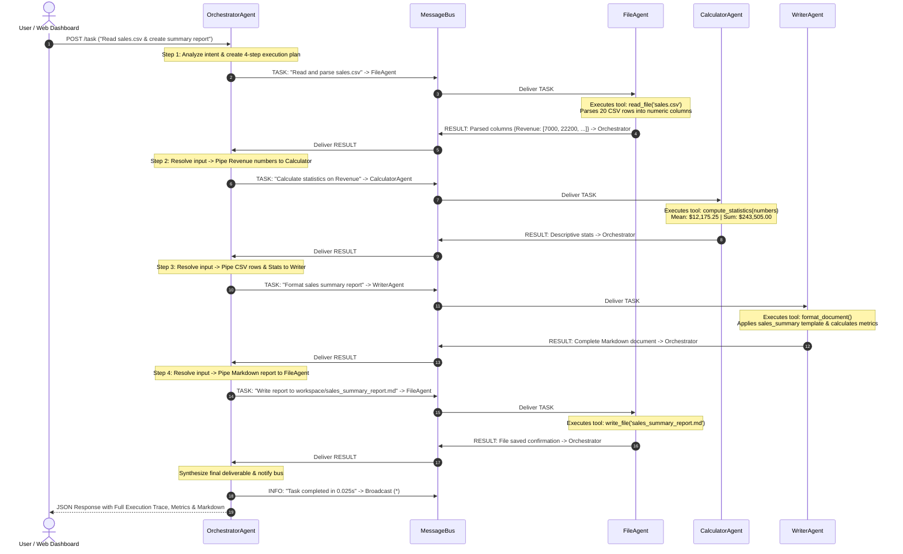

# 🤖 Multi-Agent Task Automation System

> A complete, beginner-friendly, production-ready multi-agent automation platform built in pure Python.  
> **Zero paid API keys required.** All agents, tools, message routing, and orchestrations run entirely on your local machine.

---

## 📑 Table of Contents

- [1. What are AI Agents? (Beginner Friendly)](#1-what-are-ai-agents-beginner-friendly)
- [2. Single Agent vs. Multi-Agent Systems](#2-single-agent-vs-multi-agent-systems)
- [3. Key Core Concepts](#3-key-core-concepts)
  - [Agent](#agent-baseagent)
  - [Tool](#tool-tool)
  - [Message & Message Types](#message-message)
  - [Message Bus](#message-bus-messagebus)
  - [Orchestration & Delegation](#orchestration--delegation)
- [4. System Architecture Diagram](#4-system-architecture-diagram)
- [5. Message Flow Sequence Diagram](#5-message-flow-sequence-diagram)
- [6. How the Orchestrator Decides Which Agent to Use](#6-how-the-orchestrator-decides-which-agent-to-use)
- [7. Prerequisites & System Requirements](#7-prerequisites--system-requirements)
- [8. Step-by-Step Setup Guide (Windows PowerShell)](#8-step-by-step-setup-guide-windows-powershell)
- [9. How to Run and Test](#9-how-to-run-and-test)
  - [Running the Interactive Web Dashboard](#a-running-the-interactive-web-dashboard)
  - [Running CLI Headless Demonstration](#b-running-cli-headless-demonstration)
  - [Running with Docker Compose](#c-running-with-docker-compose)
- [10. Example Task Walkthroughs with Full Message Traces](#10-example-task-walkthroughs-with-full-message-traces)
  - [Task 1: Renewable Energy Research & Report](#task-1-renewable-energy-research--report)
  - [Task 2: Compound Interest Financial Modeling](#task-2-compound-interest-financial-modeling)
  - [Task 3: Sales CSV Ingestion & Summary Report](#task-3-sales-csv-ingestion--summary-report)
  - [Task 4: Python Programming Beginner Guide](#task-4-python-programming-beginner-guide)
- [11. Tutorial: How to Add a New Agent](#11-tutorial-how-to-add-a-new-agent)
- [12. Tutorial: How to Add a New Tool](#12-tutorial-how-to-add-a-new-tool)
- [13. Software Design Patterns Used](#13-software-design-patterns-used)
- [14. Common Errors & Troubleshooting](#14-common-errors--troubleshooting)
- [15. Framework Comparison: This Framework vs. LangChain vs. AutoGen vs. CrewAI](#15-framework-comparison-this-framework-vs-langchain-vs-autogen-vs-crewai)
- [16. Hands-On Beginner Learning Exercises](#16-hands-on-beginner-learning-exercises)

---

## 1. What are AI Agents? (Beginner Friendly)

A standard program simply runs code line-by-line: you give it exact instructions, and it follows them mechanically. 

An **AI Agent**, in contrast, is an **autonomous software entity** that:
1. **Perceives** an objective or goal from the user (e.g. *"Analyze last quarter's sales and create a summary report"*).
2. **Reasons & Plans** what steps are necessary to reach that goal.
3. **Acts & Uses Tools** to interact with the world (e.g., reading a CSV file, computing statistics, querying a knowledge base, or writing an output report).
4. **Reflects & Verifies** whether the action succeeded, and retries if an error occurred.

```
       +------------------------------------------------+
       |                  USER GOAL                     |
       +------------------------------------------------+
                               |
                               v
                       +---------------+
                       |  PERCEPTION   | (Understand user intent)
                       +---------------+
                               |
                               v
                       +---------------+
            +--------> |   REASONING   | (Formulate plan & select tool)
            |          +---------------+
            |                  |
            |                  v
            |          +---------------+
            |          |    ACTION     | (Execute tool / delegate work)
            |          +---------------+
            |                  |
            |                  v
            |          +---------------+
            +--------- |  OBSERVATION  | (Inspect result & error state)
                       +---------------+
                               |
                               v
                       +---------------+
                       |  FINAL OUTPUT | (Deliver result to user)
                       +---------------+
```

Unlike static scripts, agents possess **state**, **specialization**, and the ability to call **tools dynamically**.

---

## 2. Single Agent vs. Multi-Agent Systems

When people start learning about agents, they often try to build a single "super-agent" that tries to do everything: research, math, file handling, and writing all at once.

In practice, single-agent systems face severe limitations:
- **Cognitive Overload:** One prompt or logic block becomes massive and fragile.
- **Lack of Separation of Concerns:** A bug in mathematical calculation can break the report formatter.
- **No Parallelism:** Multiple subtasks cannot be divided among experts.

### The Solution: Multi-Agent Systems (MAS)

In a **Multi-Agent System**, tasks are distributed among **specialized workers** coordinated by a manager (**The Orchestrator**):

| Dimension | Single Agent System | Multi-Agent System (This Project) |
|---|---|---|
| **Structure** | One monolithic agent handles everything | Team of focused specialist agents |
| **Modularity** | Hard to add or update individual skills | Adding a new agent or tool takes under 20 lines |
| **Fault Isolation** | If math crashes, the whole prompt fails | If a worker fails, Orchestrator retries or alerts |
| **Communication** | Internal variable passing | Standardized message packets across a MessageBus |
| **Traceability** | Black box execution | Every step and message is logged and visible |

---

## 3. Key Core Concepts

This framework is built upon 5 fundamental building blocks located in [`agent_framework.py`](file:///c:/Users/itzme/Desktop/All%20Stacks/05-AI-Agents/agent_framework.py):

### Agent (`BaseAgent`)
An agent is an autonomous worker. Every agent in this system inherits from `BaseAgent` and features:
- `name`: Unique identifier (e.g., `"Researcher"`, `"Calculator"`).
- `role`: The agent's professional duty.
- `capabilities`: High-level list of skills.
- `tools`: Dictionary of registered `Tool` objects.
- `status`: Execution state (`"IDLE"`, `"BUSY"`, or `"ERROR"`).
- `receive_message(message)`: Invoked when a message arrives for this agent.
- `process_task(task)`: Core logic that executes the agent's specialty.

### Tool (`Tool`)
A tool is a function that gives an agent the power to act on the world.
- `name`: Machine identifier (e.g. `"calculate_compound_interest"`).
- `description`: Plain-English explanation of what the tool accomplishes.
- `func`: The actual callable Python function reference.
- `execute(**kwargs)`: Safely wraps function execution in a `try/except` block and returns a standardized `{ "success": bool, "result": Any, "error": str }` dictionary.

### Message (`Message`)
The standard unit of communication sent across agents:
- `sender`: The transmitting agent.
- `receiver`: The destination agent (or `'*'` for broadcast).
- `message_type`:
  - `TASK`: A work request or delegation.
  - `RESULT`: Completion payload returned by a worker.
  - `ERROR`: Exception or diagnostic alert.
  - `INFO`: Status broadcast or log entry.
- `timestamp`: Creation time for sequencing.
- `message_id`: Unique tracing UUID.
- `content`: The payload (dict, string, or dataset).

### Message Bus (`MessageBus`)
The central communication highway. Agents do **not** call each other directly; they transmit messages through the bus.
- **Decoupled:** The Researcher agent does not need to know where the Writer agent lives in memory.
- **Audit Log:** Every single message is recorded chronologically in `message_history`.
- **Thread-Safe:** Protected by a re-entrant threading lock (`threading.RLock`) for concurrency.

### Orchestration & Delegation
The process by which the **OrchestratorAgent**:
1. Analyzes a broad user prompt.
2. Breaks it down into an ordered series of subtasks.
3. Dispatches `TASK` messages to specialist agents.
4. Gathers `RESULT` messages and chains outputs forward as inputs for subsequent steps.
5. Assembles the final response delivered to the user.

---

## 4. System Architecture Diagram

```
+=======================================================================================+
|                                 USER / WEB DASHBOARD                                  |
|                              (http://localhost:5007)                                  |
+=======================================================================================+
                                        |
                            HTTP POST /task (JSON)
                                        |
                                        v
+=======================================================================================+
|                                  ORCHESTRATOR AGENT                                   |
|   - Analyzes incoming user goals using rule-based keyword & pattern decomposition     |
|   - Generates sequential multi-step execution plans                                   |
|   - Manages retries (up to 2 attempts) and error recovery                             |
|   - Chains intermediate step artifacts forward into subsequent worker prompts         |
+=======================================================================================+
                                        |
                      Dispatches and receives via MessageBus
                                        |
                                        v
+=======================================================================================+
|                                 CENTRAL MESSAGE BUS                                   |
|               (Thread-Safe In-Memory Router & Historical Event Log)                   |
+=======================================================================================+
        |                        |                       |                       |
        | TASK / RESULT          | TASK / RESULT         | TASK / RESULT         | TASK / RESULT
        v                        v                       v                       v
+---------------+        +---------------+       +---------------+       +---------------+
|  RESEARCHER   |        |  CALCULATOR   |       |    WRITER     |       |  FILE AGENT   |
|     AGENT     |        |     AGENT     |       |     AGENT     |       |     AGENT     |
+---------------+        +---------------+       +---------------+       +---------------+
| * Knowledge   |        | * Safe Math   |       | * Markdown    |       | * Read Files  |
|   Base Lookup |        |   Parser      |       |   Templates   |       |   (CSV, TXT)  |
| * Simulated   |        | * Statistics  |       | * Extractive  |       | * Write Files |
|   Web Search  |        | * Compound    |       |   Summarizer  |       |   (MD, TXT)   |
| * Pattern     |        |   Interest    |       | * Document    |       | * List Files  |
|   Extraction  |        | * ROI & APY   |       |   Metrics     |       | * Format Check|
+---------------+        +---------------+       +---------------+       +---------------+
        |                        |                       |                       |
        v                        v                       v                       v
+---------------+        +---------------+       +---------------+       +---------------+
| LOCAL KB DICT |        | PYTHON MATH / |       | JINJA2 / TEXT |       |  WORKSPACE /  |
| (10+ Technical|        | AST EVALUATOR |       |   ENGINES     |       |   sales.csv   |
|  Topic Guides)|        |               |       |               |       | employees.txt |
+---------------+        +---------------+       +---------------+       +---------------+
```

---

## 5. Message Flow Sequence Diagram

Here is what happens behind the scenes during a composite task like:  
**"Read data from workspace/sales.csv and create a summary report"**



---

## 6. How the Orchestrator Decides Which Agent to Use

The Orchestrator uses a **rule-based intention classifier** (no external AI API keys needed). It inspects the structure and vocabulary of the user prompt:

```
                                    User Prompt
                                         |
     +-----------------------------------+-----------------------------------+
     |                                   |                                   |
Contains "sales", "csv",            Contains "compound",            Contains "beginner",
"read file" & "report"              "interest", "apy"               "guide", "python"
     |                                   |                                   |
     v                                   v                                   v
[Plan: 4 Steps]                     [Plan: 2 Steps]                 [Plan: 2 Steps]
1. FileAgent (Read CSV)             1. Calculator (Finance model)   1. Researcher (Specs)
2. Calculator (Column stats)        2. Writer (Memo & schedule)     2. Writer (Roadmap & code)
3. Writer (Sales template)
4. FileAgent (Save .md)
```

### Context Chaining (Piping Outputs Forward)
When subtask $N$ completes, the Orchestrator extracts its outputs and automatically binds them into the payload of subtask $N+1$:
- When `FileAgent` finishes reading `sales.csv`, the Orchestrator extracts `numeric_columns['Revenue']` and passes it directly to `CalculatorAgent`.
- When `CalculatorAgent` outputs the statistical dictionary, the Orchestrator bundles both the CSV rows and the statistical metrics into `WriterAgent`'s context.
- When `WriterAgent` emits the finished markdown string, the Orchestrator feeds that string into `FileAgent`'s save routine.

---

## 7. Prerequisites & System Requirements

- **Operating System:** Windows 10/11, macOS, or Linux.
- **Python Version:** Python **3.9 or newer** (Python 3.11, 3.12, 3.13 tested and supported).
- **Web Browser:** Any modern browser (Chrome, Edge, Firefox, Brave) for the web dashboard.
- **Memory & Storage:** Less than 50 MB RAM, completely lightweight.

---

## 8. Step-by-Step Setup Guide (Windows PowerShell)

Open PowerShell and follow these exact steps:

### Step 1: Open Terminal in the Project Directory
```powershell
cd "c:\Users\itzme\Desktop\All Stacks\05-AI-Agents"
```

### Step 2: (Optional but Recommended) Create a Virtual Environment
```powershell
# Create a virtual environment named 'venv'
python -m venv venv

# If your PowerShell execution policy blocks activation scripts, enable it:
Set-ExecutionPolicy -Scope Process -ExecutionPolicy Bypass

# Activate virtual environment
.\venv\Scripts\Activate.ps1
```

### Step 3: Install Required Dependencies
```powershell
pip install -r requirements.txt
```

You should see:
```text
Successfully installed blinker click flask itsdangerous jinja2 markupsafe requests werkzeug
```

---

## 9. How to Run and Test

### A. Running the Interactive Web Dashboard
Start the web application on port 5007:

```powershell
python run.py
```

You will see the startup banner:
```text
============================================================================
   🤖  MULTI-AGENT TASK AUTOMATION SYSTEM — BEGINNER EDITION  🤖
============================================================================
  * Status:              ONLINE
  * Registered Agents:   5 specialized agents
     - Orchestrator   : Task Decomposer, Workflow Coordinator & Result Synthesizer
     - Researcher     : Information Retrieval & Technical Research Specialist
     - Calculator     : Mathematical, Statistical & Financial Computation Specialist
     - Writer         : Technical Documentation, Reporting & Formatting Specialist
     - FileAgent      : Workspace Storage, File I/O & Data Parsing Specialist
  * Active Tools:        15 real local tools (no paid API keys required)
  * Message Bus:         In-memory decoupled message broker with thread safety
  * Web Dashboard:       http://localhost:5007
  * Workspace Directory: c:\Users\itzme\Desktop\All Stacks\05-AI-Agents\workspace
============================================================================
```

Now open your web browser and navigate to:
👉 **[http://localhost:5007](http://localhost:5007)**

From the dashboard you can:
1. Click any of the **4 pre-built example scenario buttons**.
2. Type custom prompts into the task dispatcher.
3. Watch the **live message bus feed** update via auto-polling.
4. View the rendered markdown reports, amortization tables, and sales metrics.
5. Explore files stored in `workspace/` and inspect their raw contents in the modal viewer.

---

### B. Running CLI Headless Demonstration
If you prefer running without opening a web browser, execute the CLI demonstration script:

```powershell
# Run all 4 example scenarios sequentially
python example_tasks.py

# Or run a specific scenario by number (1 to 4):
python example_tasks.py 1   # Renewable energy report
python example_tasks.py 2   # Compound interest calculation
python example_tasks.py 3   # Sales CSV analytics
python example_tasks.py 4   # Python beginner guide
```

---

### C. Running with Docker Compose
If you have Docker installed and prefer containers:

```powershell
# Build and launch container in background
docker compose up -d --build

# View container logs
docker compose logs -f

# Stop container
docker compose down
```

The web dashboard will be accessible at `http://localhost:5007`.

---

## 10. Example Task Walkthroughs with Full Message Traces

### Task 1: Renewable Energy Research & Report
**Prompt:** `"Research and write a report about renewable energy"`

#### Agents Involved:
- `Orchestrator` (Planner)
- `Researcher` (Knowledge Base & Web Search)
- `Writer` (Markdown Report Formatter)

#### Step-by-Step Message Trace:
1. `[INFO]  Orchestrator --> *`: Starting task execution (2 steps).
2. `[TASK]  Orchestrator --> Researcher`: Topic = `"renewable energy"`.
   - Tool `knowledge_base_lookup` queries `"renewable energy"`:
     - Found: LCOE drop of 88% since 2010, 3,870 GW capacity, solar efficiency gains.
   - Tool `simulated_web_search` gathers citation URLs and snippets.
3. `[RESULT] Researcher --> Orchestrator`: Emits structured dossier.
4. `[TASK]  Orchestrator --> Writer`: Template = `"research_report"`, feeds research context.
   - Tool `format_document` creates Markdown with Table of Contents, Executive Summary, Metrics, and Sources.
   - Tool `word_count` audits document length (250+ words).
5. `[RESULT] Writer --> Orchestrator`: Emits complete Markdown document.
6. `[INFO]  Orchestrator --> *`: Task completed in 0.015 seconds.

---

### Task 2: Compound Interest Financial Modeling
**Prompt:** `"Calculate compound interest for $10000 at 5% for 10 years"`

#### Agents Involved:
- `Orchestrator` (Planner)
- `Calculator` (Financial Computation Engine)
- `Writer` (Financial Memorandum Formatter)

#### Step-by-Step Message Trace:
1. `[INFO]  Orchestrator --> *`: Starting task execution (2 steps).
2. `[TASK]  Orchestrator --> Calculator`: Extracts Principal = $10,000, Rate = 5%, Time = 10 Years.
   - Tool `calculate_compound_interest` computes formula $A = P(1 + r)^t$:
     - Final Balance: **$16,288.95**
     - Total Interest: **$6,288.95**
     - Computes year-by-year amortization breakdown schedule (Years 1 to 10).
3. `[RESULT] Calculator --> Orchestrator`: Emits financial calculations.
4. `[TASK]  Orchestrator --> Writer`: Template = `"financial_report"`.
   - Tool `format_document` formats markdown amortization schedule table and analyst insights.
5. `[RESULT] Writer --> Orchestrator`: Emits financial report.

---

### Task 3: Sales CSV Ingestion & Summary Report
**Prompt:** `"Read data from workspace/sales.csv and create a summary report"`

#### Agents Involved:
- `Orchestrator` (Planner)
- `FileAgent` (File Ingestion)
- `Calculator` (Descriptive Statistics)
- `Writer` (Executive KPI Reporting)
- `FileAgent` (Persistence)

#### Step-by-Step Message Trace:
1. `[TASK]  Orchestrator --> FileAgent`: Read `workspace/sales.csv`.
   - Tool `read_file` reads CSV.
   - `FileAgent` parses 20 transaction records and extracts numeric columns:
     `Revenue: [7000, 22200, 16560, 11600, 6600, 8400, 27750, ...]`
2. `[RESULT] FileAgent --> Orchestrator`: Emits structured dataset.
3. `[TASK]  Orchestrator --> Calculator`: Calculate descriptive statistics on Revenue.
   - Tool `compute_statistics` returns:
     - Count: `20`
     - Sum: `$243,505.00`
     - Mean: `$12,175.25`
     - Median: `$11,400.00`
     - Peak Sale: `$29,600.00`
4. `[RESULT] Calculator --> Orchestrator`: Emits stats summary.
5. `[TASK]  Orchestrator --> Writer`: Template = `"sales_summary"`.
   - Assembles KPI highlights, regional revenue table, and salesperson leaderboard.
6. `[RESULT] Writer --> Orchestrator`: Emits markdown report.
7. `[TASK]  Orchestrator --> FileAgent`: Write content to `workspace/sales_summary_report.md`.
   - Tool `write_file` saves file to disk.
8. `[RESULT] FileAgent --> Orchestrator`: Confirms file written successfully.

---

### Task 4: Python Programming Beginner Guide
**Prompt:** `"Research Python programming and create a beginner guide"`

#### Agents Involved:
- `Orchestrator` (Planner)
- `Researcher` (Knowledge Base)
- `Writer` (Curriculum Author)

#### Step-by-Step Message Trace:
1. `[TASK]  Orchestrator --> Researcher`: Topic = `"Python programming"`.
   - Retrieves Guido van Rossum (1991), PEP 8 readability standards, and AI/ML applications.
2. `[RESULT] Researcher --> Orchestrator`: Emits language history and fundamentals.
3. `[TASK]  Orchestrator --> Writer`: Template = `"beginner_guide"`.
   - Creates a structured guide with:
     - *What is Python?*
     - *Core Concepts (Variables, Structures, Control Flow, Functions)*
     - *Runnable starter code snippet*
     - *Next learning milestones checklist*
4. `[RESULT] Writer --> Orchestrator`: Emits finalized beginner guide.

---

## 11. Tutorial: How to Add a New Agent

Adding a custom agent takes **4 simple steps**:

### Step 1: Create the Agent Class in `agents/`
Create a new file, for example `agents/sentiment.py`:

```python
# agents/sentiment.py
from agent_framework import BaseAgent, Tool

def analyze_sentiment(text: str) -> dict:
    """Classifies tone as POSITIVE, NEGATIVE, or NEUTRAL based on keywords."""
    pos_words = {"great", "excellent", "love", "profit", "growth", "high", "good"}
    neg_words = {"loss", "bad", "drop", "failure", "risk", "poor", "error"}
    
    words = set(text.lower().split())
    pos_count = len(words.intersection(pos_words))
    neg_count = len(words.intersection(neg_words))
    
    if pos_count > neg_count:
        sentiment = "POSITIVE"
    elif neg_count > pos_count:
        sentiment = "NEGATIVE"
    else:
        sentiment = "NEUTRAL"
        
    return {"sentiment": sentiment, "positive_score": pos_count, "negative_score": neg_count}

class SentimentAgent(BaseAgent):
    def __init__(self, name: str = "SentimentAnalyst"):
        super().__init__(
            name=name,
            role="Tone & Sentiment Analysis Specialist",
            capabilities=["Text Sentiment Classification", "Polarity Scoring"]
        )
        # Register tool
        self.register_tool(Tool("analyze_sentiment", "Classifies tone", analyze_sentiment))

    def process_task(self, task):
        text = task.get("text", str(task)) if isinstance(task, dict) else str(task)
        tool = self.tools["analyze_sentiment"]
        return tool.execute(text=text)["result"]
```

### Step 2: Export in `agents/__init__.py`
```python
from .sentiment import SentimentAgent
__all__ = [..., "SentimentAgent"]
```

### Step 3: Register on the Message Bus in `app.py`
```python
from agents import SentimentAgent

sentiment_agent = SentimentAgent()
message_bus.register_agent(sentiment_agent)
```

### Step 4: Teach Orchestrator to Delegate (in `agents/orchestrator.py`)
In `analyze_task()`:
```python
if "sentiment" in task_description.lower():
    steps.append({
        "step": 1,
        "agent": "SentimentAnalyst",
        "action": "analyze_sentiment",
        "description": "Analyze text tone",
        "payload": task_description
    })
```

That's it! Your new agent is fully integrated into the swarm and visible in the web dashboard!

---

## 12. Tutorial: How to Add a New Tool

Want to give existing agents new powers? Follow these 3 steps:

### Step 1: Write the Tool Function in `tools.py`
```python
# tools.py
def convert_currency(amount: float, from_curr: str, to_curr: str) -> dict:
    """Converts amounts between USD, EUR, GBP, and JPY using exchange rates."""
    rates_to_usd = {"USD": 1.0, "EUR": 1.08, "GBP": 1.28, "JPY": 0.0067}
    
    amount_in_usd = amount * rates_to_usd.get(from_curr.upper(), 1.0)
    converted = amount_in_usd / rates_to_usd.get(to_curr.upper(), 1.0)
    
    return {
        "original": f"{amount} {from_curr.upper()}",
        "converted": f"{round(converted, 2)} {to_curr.upper()}",
        "rate": round(rates_to_usd[from_curr.upper()] / rates_to_usd[to_curr.upper()], 4)
    }
```

### Step 2: Wrap in `Tool` Object in `tools.py`
Add to `get_calculator_tools()`:
```python
Tool(
    name="convert_currency",
    description="Convert between USD, EUR, GBP, and JPY currencies",
    func=convert_currency,
    parameters_doc="amount: float, from_curr: str, to_curr: str"
)
```

### Step 3: Call It Inside the Agent
The Calculator agent will automatically register the new tool on startup via `get_calculator_tools()`. The agent can invoke it using:
```python
res = self.tools["convert_currency"].execute(amount=100, from_curr="USD", to_curr="EUR")
```

---

## 13. Software Design Patterns Used

| Design Pattern | Where It Is Used | Purpose |
|---|---|---|
| **Orchestrator-Worker** | `OrchestratorAgent` & Specialists | Decomposes large goals into smaller tasks and aggregates specialist outputs. |
| **Message Broker / Bus** | `MessageBus` | Fully decouples communication between agents; avoids direct hardcoded references. |
| **Command Pattern** | `Tool` & `Message` | Encapsulates function calls and requests into standardized runnable objects with error handling. |
| **Strategy Pattern** | `WriterAgent` Templates | Swaps document drafting algorithms dynamically (Research vs Financial vs Sales vs Guide). |
| **Template Method** | `BaseAgent` | Defines the standard lifecycle (`receive_message`, `process_task`, `get_status`) for all subclasses. |

---

## 14. Common Errors & Troubleshooting

### Error: `Address already in use: Port 5007`
**Cause:** Another process or previous instance is running on port 5007.  
**Fix:**
```powershell
# Find process on port 5007
Get-Process -Id (Get-NetTCPConnection -LocalPort 5007).OwningProcess | Stop-Process -Force
```
Or start the app on a custom port:
```powershell
$env:PORT=5008
python run.py
```

---

### Error: `Execution of scripts is disabled on this system` (PowerShell)
**Cause:** Default Windows PowerShell security policy blocks virtual environment activation.  
**Fix:** Run this once in your current PowerShell session:
```powershell
Set-ExecutionPolicy -Scope Process -ExecutionPolicy Bypass
```

---

### Error: `UnicodeEncodeError: 'charmap' codec can't encode character`
**Cause:** Legacy Windows command prompts using default code page 1252.  
**Fix:** The code in this repository includes automatic `sys.stdout.reconfigure(encoding="utf-8")`. If needed in custom scripts, run:
```powershell
[Console]::OutputEncoding = [System.Text.Encoding]::UTF8
```

---

### Error: `PermissionError: Access denied: '...' escapes workspace boundary`
**Cause:** An agent or prompt attempted path traversal (e.g. `../../sensitive.txt`).  
**Fix:** This is an intentional security guard in [`tools.py`](file:///c:/Users/itzme/Desktop/All%20Stacks/05-AI-Agents/tools.py#L180-L195) enforcing that all file operations remain strictly confined to the `workspace/` folder.

---

## 15. Framework Comparison: This Framework vs. LangChain vs. AutoGen vs. CrewAI

| Feature | This Framework (05-AI-Agents) | LangChain / LangGraph | Microsoft AutoGen | CrewAI |
|---|---|---|---|---|
| **Primary Goal** | **Educational & Transparent**: Understand core agent mechanics from scratch | General-purpose LLM orchestration library | Multi-agent conversational chat loops | Role-playing agent teams with tasks |
| **Paid API Keys Required?** | ❌ **None** (100% free, runs completely offline) | ✅ Yes (OpenAI, Anthropic, or local Ollama) | ✅ Yes (OpenAI or Azure) | ✅ Yes (OpenAI / Anthropic) |
| **Learning Curve** | 🟢 **Gentle / Beginner**: Plain Python, minimal abstractions | 🔴 **Steep**: Complex chains, graphs, schemas | 🟡 **Moderate**: Conversation managers | 🟡 **Moderate**: Opinionated hierarchy |
| **Message Architecture** | Point-to-point & broadcast message bus | Directed Acyclic Graph (DAG) / StateGraph | GroupChat conversation threads | Sequential or hierarchical tasks |
| **Tool Execution** | Standard Python callables with safety wrappers | Dynamic LangChain `@tool` decorators | Function calling via OpenAI schema | LangChain tool bindings |
| **Code Size** | ~1,500 lines total (fully readable in 1 afternoon) | > 100,000 lines across dozens of packages | > 50,000 lines | > 30,000 lines |

---

## 16. Hands-On Beginner Learning Exercises

Ready to test your understanding? Try these 5 exercises:

### Exercise 1: Add a Discount Calculator Tool
- **Goal:** In `tools.py`, create a `calculate_discount(original_price, discount_percent)` function.
- **Challenge:** Add it to `CalculatorAgent` and verify by running: `"Calculate a 20% discount on $250"`.

### Exercise 2: Add an Employee Directory Searcher
- **Goal:** In `agents/file_agent.py`, add a method to parse `workspace/employees.txt`.
- **Challenge:** When a user asks: `"Find employees in Engineering"`, have the agent return Alice Walker and Charlie Chen.

### Exercise 3: Add a Markdown-to-HTML Exporter
- **Goal:** In `agents/writer.py`, add a tool that converts Markdown headers (`#`) and bullets (`-`) to basic HTML tags (`<h1>`, `<ul>`, `<li>`).
- **Challenge:** Allow the user to request report format as `html`.

### Exercise 4: Add an Execution Timer Badge to the Web UI
- **Goal:** In `templates/dashboard.html`, display a live milliseconds stopwatch during agent task execution.

### Exercise 5: Create a "Validator" Agent
- **Goal:** Create a 6th agent called `ValidatorAgent`.
- **Challenge:** Have the Orchestrator pass any report generated by the Writer to the Validator before finalizing to ensure the report contains at least 3 sections.

---

## 📄 License & Attribution

Created for learning and teaching AI Agent architectures. Free to adapt, modify, and build upon!
